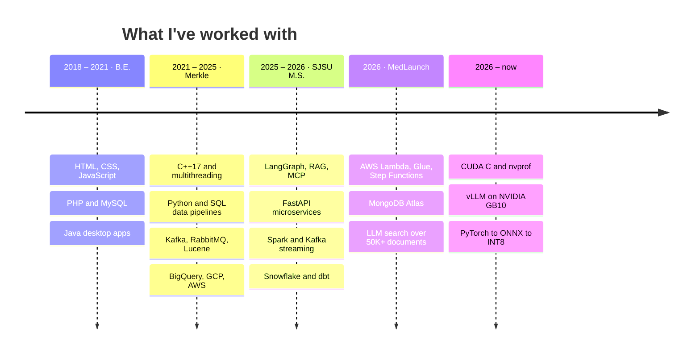

## Hi, I'm Nikhil 👋

I'm a software engineer working on **AI agents, GPU performance, and data systems**. I'm doing an M.S. in Data Intelligence at San José State University (graduating December 2027). Before that, I spent four years at Merkle (Dentsu) building data platforms and C++/Python backend services, and in summer 2026 I interned at MedLaunch Concepts, building LLM search and AWS data pipelines.

### Projects I'm proud of

| Project | What it is | Stack |
|---|---|---|
| [**CrewQuarters**](https://github.com/Nikhil-Khaneja/crewquarters) | A self-hosted AI-agent platform for NVIDIA GB10 / DGX Spark. It serves open-weight LLMs with vLLM, admits a model only if GPU memory and KV-cache budget allow, and runs agents in sandboxed Docker containers. | Python, vLLM, CUDA, Docker, PostgreSQL |
| [**GPU Performance Benchmarking**](https://github.com/Nikhil-Khaneja/gpu-performance-benchmarking) | A CUDA C matmul kernel profiled with nvprof (1,527x over a CPU loop), plus an RTX 5090 study: roofline model, FP32→FP8 GEMM throughput, and fused vs. naive attention (7.2x). | CUDA C, PyTorch, nvprof |
| [**edge-vision-npu**](https://github.com/Nikhil-Khaneja/edge-vision-npu) | Vision models trained from scratch in PyTorch, exported to ONNX, and compiled to INT8 for a Mobilint NPU. | PyTorch, ONNX, INT8 |
| [**LinkedIn Simulation**](https://github.com/Nikhil-Khaneja/Linkedin_Simulation_LLM_Agent_Microservices) | A distributed LinkedIn clone with 8 FastAPI microservices, Kafka async flows, Redis caching, and LLM recruiter and career-coach agents. | FastAPI, Kafka, Redis, React, AWS |
| [**VoltWise**](https://github.com/Nikhil-Khaneja/VoltWise) | Started in 2020 as a Java bill generator; now an analytics engine on 2M meter readings that cuts a home's peak demand 53% with battery dispatch. | Java, MySQL, linear programming |

### Tech over the years

SnowPro Core certified · 1st prize, Study Link Hackathon

### Find me

[LinkedIn](https://linkedin.com/in/khanejan) · San Jose, CA
