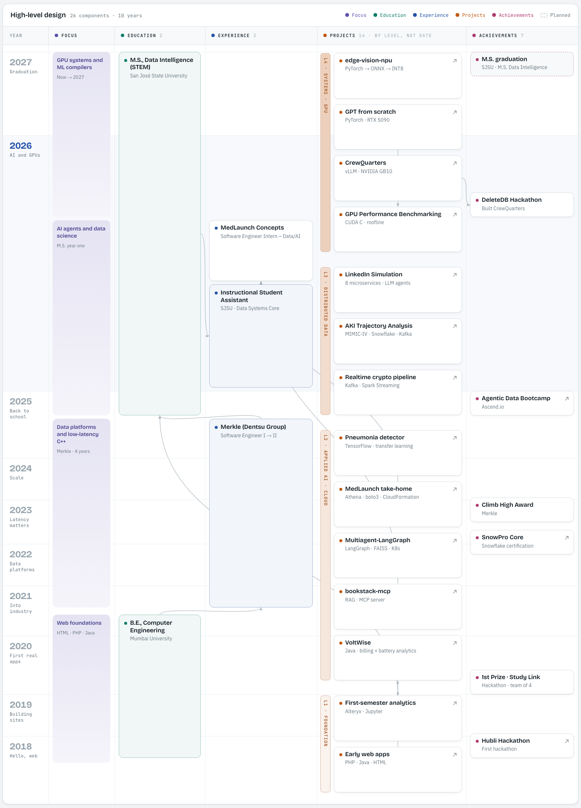

## Hi, I'm Nikhil 👋

I'm a software engineer working on **AI agents, GPU performance, and data systems**. I'm doing an M.S. in Data Intelligence at San José State University (graduating December 2027). Before that, I spent four years at Merkle (Dentsu) building data platforms and C++/Python backend services, and in summer 2026 I interned at MedLaunch Concepts, building LLM and AWS pipelines.

### HLD of my work

Click the map to open the interactive version, where each block opens its LLD: the story, an architecture diagram, the tools, and links.

<a href="https://nikhil-khaneja.github.io/Nikhil-Khaneja/career-map/">
  <picture>
    <source media="(prefers-color-scheme: dark)" srcset="assets/career-map-dark.png">
    
  </picture>
</a>

### What I'm building

| Project | What it is | Stack |
|---|---|---|
| [**CrewQuarters**](https://github.com/Nikhil-Khaneja/crewquarters) | A self-hosted AI-agent platform for NVIDIA GB10 / DGX Spark. It serves open-weight LLMs with vLLM, runs agents in sandboxed Docker containers, and ships as an offline `.deb` for air-gapped installs. | Python, vLLM, CUDA, Docker, PostgreSQL |
| [**GPU Performance Benchmarking**](https://github.com/Nikhil-Khaneja/gpu-performance-benchmarking) | A CUDA C matmul kernel profiled with nvprof (1,527x over a CPU loop), plus an RTX 5090 study: roofline model, FP32→FP8 GEMM throughput, and fused vs. naive attention. | CUDA C, PyTorch, nvprof |
| [**edge-vision-npu**](https://github.com/Nikhil-Khaneja/edge-vision-npu) | PyTorch vision models trained from scratch, exported to ONNX, and compiled to INT8 for a Mobilint NPU. | PyTorch, ONNX, INT8 |
| [**LinkedIn Simulation**](https://github.com/Nikhil-Khaneja/Linkedin_Simulation_LLM_Agent_Microservices) | A distributed LinkedIn clone with 8 FastAPI microservices, Kafka async flows, Redis caching, and LLM career-coach agents. | FastAPI, Kafka, Redis, React, AWS |
| [**AKI Trajectory Analysis**](https://github.com/Nikhil-Khaneja/AKI_trajectory_Analysis) | A big-data pipeline on MIMIC-IV that stages acute kidney injury and predicts patient deterioration from ICU streams. | PySpark, Kafka, Python |
| [**bookstack-mcp**](https://github.com/Nikhil-Khaneja/bookstack-mcp) | A RAG backend with a LangGraph pipeline, guardrails, SSE streaming, and an MCP server that lets agents query the knowledge base. | FastAPI, LangGraph, pgvector, MCP |

### Tech I use

- **Languages:** Python · C++ · SQL · Java
- **ML & AI:** PyTorch · vLLM · LangGraph · RAG · ONNX · scikit-learn
- **GPU & performance:** CUDA · nvprof · profiling · benchmarking
- **Data & infra:** Kafka · Spark · Snowflake (SnowPro Core certified) · PostgreSQL · Docker · Kubernetes · AWS · GCP

### Find me

[LinkedIn](https://linkedin.com/in/khanejan) · San Jose, CA
