  

  
  
  

I build **AI agents, GPU-aware systems and data platforms**, and I like proving things with measurements: a CUDA kernel timed against a CPU reference, a GPU pushed to its roofline, a model checked against ONNX Runtime before it ships to an NPU. Before my M.S. at SJSU, I spent four years at Merkle (Dentsu) building data platforms and C++/Python backend services. In summer 2026 I built LLM search and AWS data pipelines at MedLaunch Concepts.

<h2>🗺️ System map</h2>

  

<h2>🔥 Highlighted work</h2>

<table>
<tr>
<td width="50%"></td>
<td width="50%"></td>
</tr>
<tr>
<td width="50%"></td>
<td width="50%"></td>
</tr>
<tr>
<td width="50%"></td>
<td width="50%"></td>
</tr>
</table>

<h2>🧰 Toolbox</h2>

  <b>Languages</b> 
  
  
  
  
  

  <b>AI and GPU</b> 
  
  
  
  
  
  
  
  

  <b>Data</b> 
  
  
  
  
  
  

  <b>Backend and storage</b> 
  
  
  
  
  
  

  <b>Cloud and infra</b> 
  
  
  
  
  
  

<h2>🏆 Milestones</h2>

- 🥇 **1st prize, Study Link Hackathon**: led a team of 4 from problem to shipped prototype in 12 hours
- ❄️ **SnowPro Core certified** (Snowflake)
- 🧗 **Climb High Award** at Merkle
- 🛠️ **DeleteDB Hackathon**: where CrewQuarters started

<h2>📫 Find me</h2>

  
  

